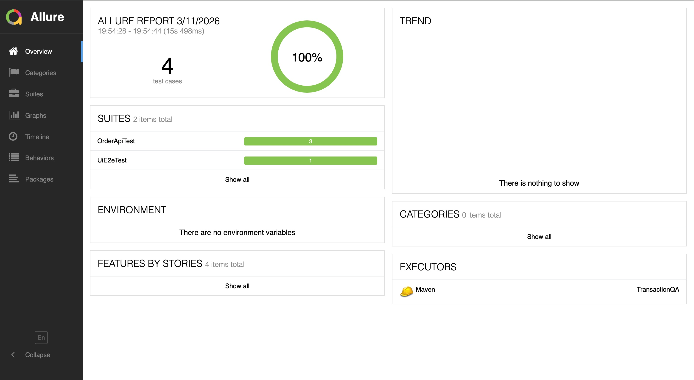

# TransactionQA

A QA practice project covering the three layers of testing a transaction system: REST API tests, end-to-end UI tests and SQL checks, run in Jenkins with Allure reports.



## What's covered

| Layer | Tooling | Target |
| --- | --- | --- |
| API | REST Assured + JUnit 5 | [Swagger Petstore](https://petstore.swagger.io/) orders: create an order, fetch it by id, handle a missing order |
| UI end-to-end | Playwright for Java | [ParaBank](https://parabank.parasoft.com/) demo bank: log in and check the account balance |
| Database | SQL | Queries over a users / accounts / transactions schema (`test_queries.sql`) |
| Reporting | Allure | Test results with steps and attachments |
| CI | Jenkins | `Jenkinsfile` checks out the repo, runs `mvn clean test` and publishes the Allure report |

## Running locally

```bash
mvn clean test
mvn allure:serve   # opens the report in the browser
```

Playwright downloads its browsers on the first run.
